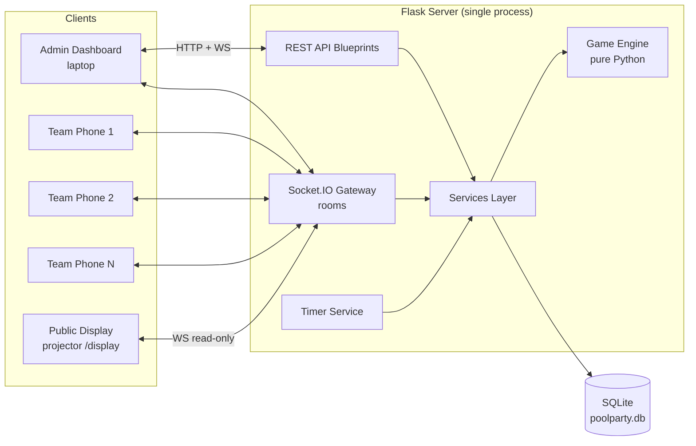
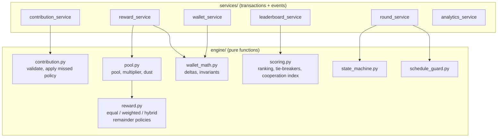
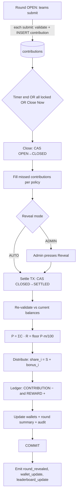
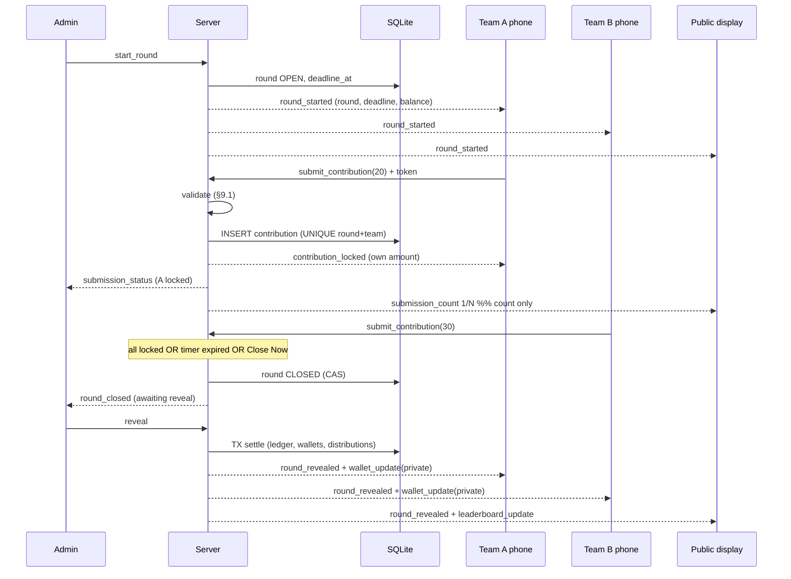
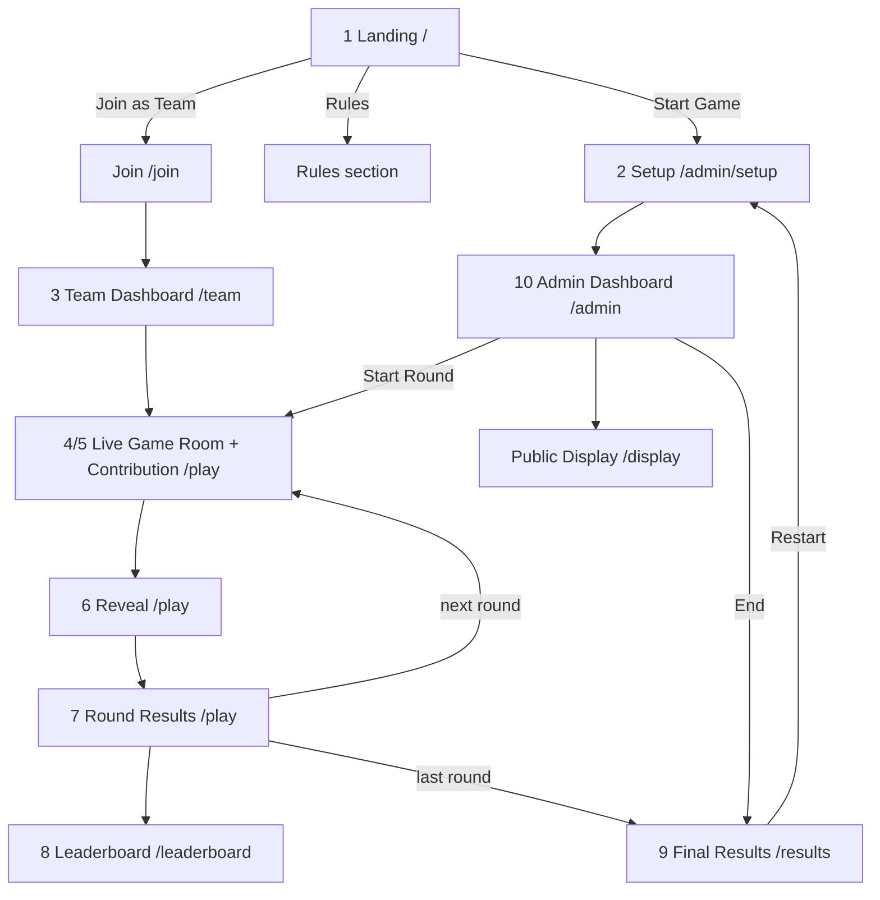

# POOL PARTY — Game Architecture & Development Blueprint

> **Tagline:** Win-win cooperation.
> **Event type:** College Game Development Event · ~1 hour live session
> **Document status:** Blueprint v1.0 (no code yet) · Visual theme: **"Pixel Forge" style** (§14)
> **Companion documents:** `GAME_ARCHITECTURE.md` (TRUST FALL), `SILENT_AUCTION_ARCHITECTURE.md`. All three games share the same stack, theme, auth model and project skeleton, so one team can build them as a suite.

---

## Table of Contents

1. [Project Overview](#1-project-overview)
2. [Problem Statement](#2-problem-statement)
3. [Game Concept & Game-Theory Notes](#3-game-concept--game-theory-notes)
4. [Functional Requirements](#4-functional-requirements)
5. [Non-Functional Requirements](#5-non-functional-requirements)
6. [Complete Game Rules & Configuration](#6-complete-game-rules--configuration)
7. [Dynamic Team Management](#7-dynamic-team-management)
8. [Token Wallet System](#8-token-wallet-system)
9. [Contribution Mechanism](#9-contribution-mechanism)
10. [Pool Calculation](#10-pool-calculation)
11. [Reward Distribution](#11-reward-distribution)
12. [System Architecture](#12-system-architecture)
13. [User Roles](#13-user-roles)
14. [UI Theme & Design System (Pixel Forge Style)](#14-ui-theme--design-system-pixel-forge-style)
15. [UI/UX Page Structure](#15-uiux-page-structure)
16. [Database Schema](#16-database-schema)
17. [Entity Relationship Diagram](#17-entity-relationship-diagram)
18. [API Documentation](#18-api-documentation)
19. [WebSocket Architecture](#19-websocket-architecture)
20. [Algorithms: Contribution, Reward, Wallet Transaction, Winner](#20-algorithms-contribution-reward-wallet-transaction-winner)
21. [Game Lifecycle](#21-game-lifecycle)
22. [Security Architecture](#22-security-architecture)
23. [Edge-Case Handling](#23-edge-case-handling)
24. [Analytics & Statistics](#24-analytics--statistics)
25. [Project Directory Structure](#25-project-directory-structure)
26. [Testing Strategy](#26-testing-strategy)
27. [Deployment & Event-Day Architecture](#27-deployment--event-day-architecture)
28. [Detailed Development Roadmap](#28-detailed-development-roadmap)
29. [Master To-Do Checklist](#29-master-to-do-checklist)
30. [Final Event-Day Launch Checklist](#30-final-event-day-launch-checklist)
31. [Assumptions & Unresolved Design Decisions](#31-assumptions--unresolved-design-decisions)

Legend: **[MUST]** = mandatory · **[OPT]** = optional enhancement

---

## 1. Project Overview

POOL PARTY is a browser-based, real-time, multi-device team game inspired by the **Public Goods Game**. Every team starts with the same number of virtual tokens. In each round, every team **secretly** decides how many tokens to put into a shared pool. The pool is multiplied (default ×2) and split equally among **all** teams — including teams that contributed nothing. After several rounds, the team with the most tokens wins.

The tension is the point: contributing grows the pot for everyone, but holding back while others contribute is individually more profitable. The room learns, in about an hour, how cooperation emerges, collapses, or recovers.

One **administrator** runs the session. Each **team** plays from its own phone. A **public display** page shows the room the countdown, the dramatic pool reveal, the reward distribution and the leaderboard.

## 2. Problem Statement

Running a public-goods experiment by hand (paper slips, mental arithmetic) is slow, error-prone and leaks contributions. The event needs:

- **Secret contributions** nobody can peek at before the reveal.
- **Exact integer token accounting** — no tokens silently created or lost, even when the reward does not divide evenly.
- **Atomic, tamper-proof wallets** with a full ledger.
- A **dynamic number of teams** and rounds, without code changes.
- A show-worthy reveal (pool growing, multiplier, coin distribution) that keeps ~1 hour of play engaging, with the administrator controlling the pace.

## 3. Game Concept & Game-Theory Notes

| Element | Description |
|---|---|
| Players | N teams (N ≥ 2; no fixed maximum; tested to 20+) |
| Currency | Integer tokens, equal initial balance (configurable) |
| Round decision | One secret integer contribution `0 … balance` |
| Pool | Sum of contributions, multiplied by `M`, split equally (default) |
| Rounds | Configurable (default 5) |
| Winner | Highest final token balance (tie-breakers in §20.5) |

### 3.1 Why the game is a dilemma (and when it isn't)

Define the **marginal per-capita return** `MPCR = M / N`: each token a team contributes returns `M/N` tokens to *itself*.

| Condition | Meaning | Effect |
|---|---|---|
| `M ≤ 1` | Pool never grows | Pointless; contributing only loses tokens |
| `1 < M < N` | **Real social dilemma** | Contributing costs you `1 − M/N > 0` per token, but the group gains `M − 1`. Free-riding is individually best; full cooperation is collectively best |
| `M ≥ N` | Contributing returns ≥ 1 per token | No dilemma — everyone should contribute everything |

**Setup page rule:** show `MPCR` live; **warn** if `M ≤ 1` or `M ≥ N` ("this setting removes the dilemma"). The default (N = 5, M = 2 → MPCR = 0.4) is a genuine dilemma.

### 3.2 Reference outcomes (N = 5, M = 2, 100 tokens, one round)

| Scenario | Contributions | Pool → Reward | Share each | Final balances |
|---|---|---|---:|---|
| Everyone defects | 0,0,0,0,0 | 0 → 0 | 0 | 100 each |
| **Everyone cooperates** | 100 ×5 | 500 → 1000 | 200 | **200 each** |
| One free-rider | 100 ×4, 0 | 400 → 800 | 160 | Free-rider **260**; others **160** |

The free-rider beats the cooperators (260 vs 160), but if everyone reasons the same way, all end at 100 instead of 200. That is the dilemma.

### 3.3 Two game-design cautions
- **End-game effect.** In the last known round there is no future to protect, so rational teams drop contributions to 0. Options: keep the final round announced (default, teaches the effect), or hide the round count / use a random end [OPT] (decision D-2).
- **Winning vs. cooperating.** The winner is the richest team, which usually rewards free-riding. The final screen therefore also shows a **Group Cooperation Index** and a **Most Cooperative** badge, so the room sees collective success next to individual victory (§24).

---

## 4. Functional Requirements

### 4.1 Mandatory [MUST]

| ID | Requirement |
|---|---|
| FR-01 | Admin creates a game session; receives session code and admin access. |
| FR-02 | Admin enters team count; UI dynamically generates N name fields; names validated unique (case-insensitive). |
| FR-03 | Wallet per team initialized with the configured token balance (integer). |
| FR-04 | Configurable: initial tokens, number of rounds, multiplier, round duration, min/max contribution, missed-submission behavior, distribution mode. |
| FR-05 | Per round: one secret whole-number contribution per team, `0 ≤ c ≤ balance`, immutable after submission. |
| FR-06 | Round closes when the timer expires, all teams have submitted (configurable), or admin closes it. |
| FR-07 | Reveal all contributions simultaneously; compute pool, multiplied reward, equal shares with deterministic remainder handling. |
| FR-08 | Contributions are deducted and rewards credited **atomically, exactly once**, through an append-only ledger. |
| FR-09 | Team dashboard: initial allocation, balance, total contributed, total rewards, net gain, round-wise history, rank. |
| FR-10 | Round results table: previous balance · contribution · reward · new balance. |
| FR-11 | Live leaderboard updated automatically after each round. |
| FR-12 | Admin controls: start, pause, resume, start next round, close round, reveal, end, reset (confirmed); every action audit-logged. |
| FR-13 | Final results: winner, top three, balances, totals, statistics, contribution trend charts. |
| FR-14 | Public display page (no secrets before the reveal). |
| FR-15 | State survives refresh and server restart (DB is source of truth). |
| FR-16 | All calculations on the backend. |

### 4.2 Optional [OPT]

| ID | Enhancement |
|---|---|
| OP-01 | Mode B (contribution-weighted) and Mode C (hybrid) distribution. |
| OP-02 | Discussion phase between rounds (timed, "talk before you decide"). |
| OP-03 | Hidden round count / random end (anti end-game effect). |
| OP-04 | Anonymous contribution reveal (amounts shown, names hidden). |
| OP-05 | Sound effects (coin clink, splash, tick). |
| OP-06 | CSV/PDF export of results and ledger. |
| OP-07 | Group target: bonus celebration if the room's cooperation index ≥ X %. |
| OP-08 | Encrypt contributions at rest until reveal. |
| OP-09 | Pixel confetti and podium animation. |

## 5. Non-Functional Requirements

| Category | Target |
|---|---|
| **Performance** | State change → all clients < 1 s on LAN; ≥ 40 concurrent clients; settlement transaction < 500 ms for 40 teams. |
| **Integrity** | Balances never negative; `balance == SUM(ledger)`; global conservation invariant holds every round (§10.3). |
| **Fairness** | No contribution amount (and no running pool total) leaves the server before reveal. |
| **Usability** | Mobile-first team screen; large numeric input with chips; ≥ 48 px tap targets; one-tap confirm. |
| **Simplicity** | One server process, one SQLite file, no external services. |
| **Cost** | ₹0 — open-source / free tier only. |
| **Maintainability** | Pure-Python engine isolated from Flask/DB; heavy unit tests on the reward engine. |
| **Accessibility** | Icon + text for every state; contrast ≥ 4.5:1; reduced-motion support. |
| **Portability** | Runs on an organizer laptop over LAN/hotspot (primary) or free WS-capable host (backup). |

---

## 6. Complete Game Rules & Configuration

1. Admin configures teams and rules; teams join; admin starts.
2. The game runs for `rounds` rounds. In each round every team has the same decision at the same time.
3. Each team submits **one** contribution (integer, `min ≤ c ≤ min(balance, max)`), or does nothing (default → 0).
4. Round closes (timer, all submitted, or admin **Close Now**).
5. Admin presses **Reveal** (or reveal is automatic, per setting). All contributions appear at once.
6. Server computes pool → multiplied reward → shares; ledger rows are written; wallets update.
7. Results and leaderboard show; admin (or timer) starts the next round.
8. After the final round, final scores are computed and the winner announced.
9. Teams must not communicate during an open contribution window unless the optional discussion phase is enabled (honor rule).

### 6.1 Configuration Table (all admin-editable until Start)

| Setting | Default | Range / Options |
|---|---:|---|
| Number of teams | 5 | 2–40 |
| Initial tokens per team | 100 | 1–1,000,000 |
| Number of rounds | 5 | 1–50 |
| Pool multiplier `M` | 2.0 | stored as integer hundredths (`multiplier_x100`), 0.00–10.00, step 0.05 |
| Round (contribution) duration | 120 s | 15–900 s |
| Minimum contribution | 0 | 0 … max |
| Maximum contribution | Current balance | `BALANCE`, absolute number, or % of balance |
| Missed-submission behavior | `ZERO` | `ZERO` / `SAME_AS_LAST` / `MINIMUM` |
| Reward distribution | `EQUAL` (Mode A) | `EQUAL` / `WEIGHTED` / `HYBRID` [OPT] |
| Hybrid equal share α | 50 % | 0–100 [OPT] |
| Remainder policy | `ROTATING` | `ROTATING` / `TO_LOWEST_BALANCE` / `CARRY_OVER` |
| Reveal mode | `ADMIN` | `ADMIN` / `AUTO` |
| Next-round mode | `ADMIN` | `ADMIN` / `AUTO` |
| Auto-close when all submitted | on | on / off |
| Reveal display time (auto mode) | 60 s | 10–300 s |
| Discussion phase [OPT] | 0 s (off) | 0–300 s |
| Target total duration | 60 min | for schedule guard |
| Auto catch-up | on | on / off |
| Public contributions | named | `NAMED` / `ANONYMOUS` [OPT] |
| Announce final round | yes | yes / no [OPT] |
| Final tie-breakers | `TOTAL_CONTRIBUTED, NET_GAIN, NAME` | ordered list |

### 6.2 Admin-Controlled Progression & One-Hour Guard
- **One device per team** keeps contributions private (re-join from a new device only if admin allows; token rotation locks out the old one).
- Admin presses **Start Round → Close Now (optional) → Reveal → Next Round**. Auto modes can replace any button.
- **Schedule guard:** the server computes `planned_end` from remaining rounds × (contribution + reveal + buffer). When behind target by more than 3 min, the admin sees "Behind by X min" with suggestions; with `auto_catch_up` on, the server switches to AUTO reveal/next and shortens upcoming timers proportionally (never below 30 s). Admin can override at any time.

### 6.3 Timing Budget (60-minute event)

Per round ≈ contribution + reveal/results + buffer (+ discussion if enabled).

| Rounds | Contribution | Reveal/results | Buffer | Discussion | Total | Fits in 60 min? |
|---:|---:|---:|---:|---:|---:|---|
| 5 | 120 s | 75 s | 15 s | 0 | ~17.5 min | ✔ (add discussion) |
| 8 | 120 s | 75 s | 15 s | 0 | ~28 min | ✔ |
| 10 | 120 s | 75 s | 15 s | 60 s | ~35 min | ✔ |
| 12 | 90 s | 60 s | 15 s | 60 s | ~33 min | ✔ |
| 15 | 120 s | 75 s | 15 s | 60 s | ~52 min | tight; use guard |

The setup page shows this estimate live as inputs change.

---

## 7. Dynamic Team Management

**Workflow:** admin opens Setup → enters team count → UI renders N name inputs → names validated (trimmed, 1–30 chars, case-insensitive unique) → admin confirms → server creates `teams` rows, `team_wallets` rows and join codes → admin continues to configuration → Start (initial tokens granted via `INITIAL_GRANT` ledger rows).

| Rule | Detail |
|---|---|
| Team count | 2–40; no code changes needed; N is simply the row count |
| Team ID | Auto-increment integer + random `join_code` (e.g. `OTTER-7K2`) |
| Seed order | Random shuffle at confirmation (stored `seed`); used by the rotating remainder rule |
| Per-team info | ID, name, wallet balance, total contributed, total rewards, net gain, items "history", rank |
| Edits | Names editable until Start; after Start read-only |
| Late join | Only registered teams can join/re-join; no new teams after Start |

---

## 8. Token Wallet System

### 8.1 Wallet Display (team dashboard) [MUST]
Initial allocation · current balance · total contributed · total rewards received · net gain/loss (`balance − initial`) · round-wise transaction history · current rank.

### 8.2 Wallet Rules
- Contribution ≤ current balance; integers only; zero allowed.
- Contributions immutable after submission.
- Rewards credited automatically at settlement.
- `CHECK (balance >= 0)` in the database as a last line of defense.
- Every token movement is a ledger row.

### 8.3 Ledger (append-only `transactions`)

| kind | sign | When |
|---|---|---|
| `INITIAL_GRANT` | + | Game start, one per team |
| `CONTRIBUTION` | − | Settlement of each round (amount = contribution) |
| `REWARD` | + | Settlement of each round (amount = share incl. remainder bonus) |
| `ADJUSTMENT` | ± | Admin correction (typed confirm + note; audited) |

UPDATE/DELETE on `transactions` are blocked by triggers. Each row stores `balance_after`. **Invariant:** `team_wallets.balance == SUM(transactions.amount)` per team.

### 8.4 When tokens move (design decision)
Contributions are **recorded** at submission (secret store, `contributions` table) but tokens are **deducted at settlement**, in the same transaction that credits rewards. Because balances cannot change mid-round (except admin adjustments while paused), the submit-time check `c ≤ balance` stays valid, and settlement re-validates. This makes "deduct + reward" one atomic unit that either fully applies or not at all.

### 8.5 Preventing Double Application
1. **Idempotency keys:** `contrib:{round_id}:{team_id}` and `reward:{round_id}:{team_id}` — `UNIQUE` on `transactions.idempotency_key`.
2. **Status compare-and-swap:** `UPDATE game_rounds SET status='SETTLED' WHERE id=:id AND status='CLOSED'` — only the caller that changes exactly one row settles.
3. **Single transaction** (`BEGIN IMMEDIATE`): ledger rows + wallet updates + reward distribution rows + round summary + audit log.
4. **Guarded wallet update:** `UPDATE team_wallets SET balance = balance + :delta WHERE team_id=:t AND balance + :delta >= 0`; `rowcount` must be 1.
5. **UI safety:** admin buttons disable after click; endpoints are idempotent and return the stored result on repeat.

---

## 9. Contribution Mechanism

### 9.1 Submission Rules (server-enforced)

| Rule | Detail | Error code |
|---|---|---|
| Round open | Status `OPEN`, server time < `deadline_at` (+1 s grace) | `ROUND_CLOSED` |
| Not paused | Game `IN_PROGRESS` | `GAME_PAUSED` |
| Integer | Whole number, no decimals/exponent/whitespace tricks, ≤ 12 digits | `INVALID_AMOUNT` |
| Non-negative | `amount ≥ 0` | `NEGATIVE_AMOUNT` |
| Minimum | `amount ≥ min_contribution` | `BELOW_MINIMUM` |
| Maximum | `amount ≤ min(balance, max_contribution)` | `EXCEEDS_BALANCE` / `ABOVE_MAXIMUM` |
| One only | No existing contribution for `(round, team)` | `ALREADY_SUBMITTED` |
| Team belongs | Token's team = request team | `FORBIDDEN` |

### 9.2 Secrecy
- Pre-reveal, the only data returned about contributions is **own** amount (to its owner) and **counts** (`locked / total`).
- The **running pool total is never shown** pre-reveal (it would leak the sum, letting the last submitter infer everyone else's behavior).
- Reveal is atomic: the `round_revealed` event is emitted only after the settlement transaction commits.

### 9.3 Missed Submission
At close, every team without a contribution row gets a server-generated one (`is_auto = 1`): `ZERO` (default), `SAME_AS_LAST` (clamped to current balance), or `MINIMUM`. Auto rows are flagged in the UI ("auto") and excluded from "cooperation intent" statistics (still counted in pool math).

### 9.4 Max Contribution Options
`BALANCE` (default), absolute cap (e.g. 50), or percentage of balance (e.g. 50 %, floor). Effective max = `min(balance, cap)`. A team with 0 tokens contributes 0 automatically but **still receives a share**.

---

## 10. Pool Calculation

### 10.1 Variables (integer accounting)

| Symbol | Meaning | Type |
|---|---|---|
| `N` | Number of participating teams (all registered teams) | int ≥ 2 |
| `C_i` | Contribution of team *i* | int, `0 ≤ C_i ≤ balance_i` |
| `P` | Total pool `= Σ C_i` | int |
| `m` | Multiplier in hundredths (`multiplier_x100`; 2.0 → 200) | int |
| `R` | Total reward `= ⌊ P × m / 100 ⌋` | int |
| `dust` | Discarded fraction `= (P × m mod 100) / 100` (< 1 token) | rational |
| `S` | Base equal share `= ⌊ R / N ⌋` | int |
| `r` | Remainder `= R mod N` (`0 ≤ r < N`) | int |
| `bonus_i` | 1 if team *i* is selected for the remainder, else 0 (`Σ bonus_i = r`) | 0/1 |
| `share_i` | `S + bonus_i` | int |
| `B_i'` | New balance `= B_i − C_i + share_i` | int |

### 10.2 Worked Example 1 (from the specification) — N = 4, M = 2.0, initial 100

| Team | Contribution `C_i` |
|---|---:|
| A | 20 |
| B | 30 |
| C | 10 |
| D | 0 |

`P = 20+30+10+0 = 60` · `R = 60 × 2 = 120` · `S = 120 / 4 = 30` · `r = 0`.

| Team | Previous | Contribution | Reward | New balance | Net (`reward − contribution`) |
|---|---:|---:|---:|---:|---:|
| A | 100 | 20 | 30 | **110** | +10 |
| B | 100 | 30 | 30 | **100** | 0 |
| C | 100 | 10 | 30 | **120** | +20 |
| D | 100 | 0 | 30 | **130** | +30 |
| **Total** | **400** | **60** | **120** | **460** | **+60** |

Check: `460 = 400 + (R − P) = 400 + 60` ✔. The team that contributed nothing ends richest; the highest contributor ends at break-even. That is the free-rider effect.

### 10.3 Token Conservation Invariant (tested every round)

```
Σ new_balances = Σ old_balances + (R − P)
```
Tokens are *created* only by the multiplier (`R − P`, intended and visible), *never lost* in the split (`Σ share_i = R` exactly), and fractional dust (< 1 token) is *never created in the first place*. The round record stores `P`, `R`, `S`, `r`, `dust_x100` so any round can be re-audited.

### 10.4 Worked Example 2 — rounding with a remainder (N = 4, M = 1.5)

Same contributions (20, 30, 10, 0), `m = 150`: `P = 60`, `P×m = 9000` → `R = 90`, `dust = 0`. `S = ⌊90/4⌋ = 22`, `r = 2`. Round 1, rotating remainder starts at seed index 0 → teams A and B receive +1.

| Team | Previous | Contribution | `S` | `bonus` | Reward | New |
|---|---:|---:|---:|---:|---:|---:|
| A | 100 | 20 | 22 | +1 | 23 | 103 |
| B | 100 | 30 | 22 | +1 | 23 | 93 |
| C | 100 | 10 | 22 | 0 | 22 | 112 |
| D | 100 | 0 | 22 | 0 | 22 | 122 |
| Total | 400 | 60 | 88 | 2 | **90** | **430** |

`Σ share = 90 = R` ✔ · `430 = 400 + (90 − 60)` ✔.

**Dust example:** `M = 1.25`, `P = 15`: `P×m = 1875` → `R = 18`, `dust = 0.75` token is discarded (never existed in the ledger). Shown in the admin round summary as "rounding dust 0.75".

### 10.5 Rounding Policy (recommended default)

1. Reward total is floored to an integer: `R = ⌊P·m/100⌋`.
2. Equal share `S = ⌊R/N⌋`; remainder `r = R mod N` is distributed **one token each to `r` teams**.
3. **Remainder selection (`ROTATING`, default):** order teams by `seed`; start at index `(round_no − 1) mod N`; the next `r` teams (wrapping) get +1. It is deterministic, independent of contributions (no incentive to manipulate), and every team gets equal treatment over `N` rounds.
4. Alternatives: `TO_LOWEST_BALANCE` (after contributions; ties by seed rotation — helps trailing teams), `CARRY_OVER` (remainder added to next round's pool; last-round remainder falls back to `ROTATING`).

---

## 11. Reward Distribution

### 11.1 Mode A — Equal Distribution [MUST, default]
`share_i = S + bonus_i` as above. Everyone benefits equally from the pool; free-riding is profitable. Best demonstrates the public-goods dilemma.

### 11.2 Mode B — Contribution-Weighted [OPT]
`share_i = R × C_i / P` using the **largest remainder method**: `floor(R·C_i / P)` for each team, then distribute the leftover tokens one at a time to teams with the largest fractional remainders (ties → seed rotation). If `P = 0` → all shares 0.
Example (contributions 20,30,10,0; `R = 120`): shares 40, 60, 20, 0 → balances 120, 130, 110, 100.
> Caution: with `M > 1` this mode gives each team `M × C_i` back, so contributing everything is dominant — **no dilemma**. Use only for "reward the contributors" variations.

### 11.3 Mode C — Hybrid [OPT]
`equal_part = ⌊α·R⌋` distributed as Mode A; `weighted_part = R − equal_part` distributed as Mode B.
Example (α = 50 %): `equal_part = 60` → 15 each; weighted part 60 → 20, 30, 10, 0; totals **35, 45, 25, 15**.

Modes are selected before Start and frozen. Only Mode A is required for launch.

---

## 12. System Architecture

### 12.1 Technology Choice (same as the companion games)

| Layer | Evaluated | **Chosen** | Why |
|---|---|---|---|
| Frontend | HTML/CSS/JS + Bootstrap or Tailwind | **HTML + vanilla JS + Tailwind CSS (CDN dev / CLI build prod) + CSS variables** | Custom Pixel Forge look; no framework build step |
| Charts | Chart.js / D3 / SVG | **Chart.js (self-hosted file)** | Simple, supports all five required chart types |
| Backend | Flask vs FastAPI | **Flask** | Simplest; best Socket.IO integration |
| Database | MySQL vs SQLite | **SQLite (WAL)** | Zero setup; strong transactions for the ledger; one file to back up |
| Real-time | Flask-SocketIO vs raw WebSockets | **Flask-SocketIO (gevent)** | Rooms, auto-reconnect, long-polling fallback on strict Wi-Fi |
| ORM | raw SQL vs SQLAlchemy | **SQLAlchemy** | Parameterized queries; portable to MySQL |

### 12.2 High-Level Architecture



### 12.3 Game Engine Architecture (pure Python, no Flask/DB)



### 12.4 Contribution Processing → Reward → Wallet (settlement pipeline)



### 12.5 Frontend–Backend Communication
REST for commands and state reads; Socket.IO for pushed events (timer sync, submission counts, reveal, wallet and leaderboard updates). The database is the source of truth: on connect or reconnect the client calls `GET /api/me/state`.

### 12.6 Data Flow — One Round



---

## 13. User Roles

| Role | Access | Authentication |
|---|---|---|
| **Administrator** | Setup, start/pause/resume, start round, close, reveal, adjust wallets (audited), end, reset; sees *who* has submitted, never amounts before reveal | Password (env var, bcrypt) → signed session cookie + CSRF |
| **Team** | Own wallet, own contribution, own history, revealed results, public leaderboard | Session code + team join code → HttpOnly token cookie |
| **Public display / audience** [OPT] | Read-only: round, countdown, submission count, revealed pool/rewards, leaderboard | Session code only |

---

## 14. UI Theme & Design System (Pixel Forge Style)

The look mirrors the **Pixel Forge 2026** reference: dark violet arena, chunky gold pixel typography with glow, glowing orange gradient CTAs, rounded purple-outlined info cards, and drifting pixel squares. POOL PARTY's hero art: **voxel characters around a glowing pixel pool**, tossing coin-tokens into it (echoing the hammer hero), with a big gold **×2** stamp.

### 14.1 Signature Elements

| Element | Pixel Forge reference | POOL PARTY usage |
|---|---|---|
| Background | Indigo/violet gradient with pixel blocks | Same; faint pixel bubbles rising |
| Logo | White pixel word + gold pixel word with glow, outlined year badge | `POOL` (white) + `PARTY` (gold glow) + badge `×2` (multiplier, live) |
| Tagline | Bold uppercase | `WIN-WIN COOPERATION.` + gold subline `Contribute · Multiply · Share` |
| Info cards | Rounded purple-outlined with tinted icon tile, purple label, white value | `ROUNDS`, `TEAMS`, `TOKENS`, `MULTIPLIER`; in game: `BALANCE`, `CONTRIBUTED`, `REWARDS`, `NET`, `RANK` |
| Primary CTA | Orange gradient glowing pill | `START GAME →`, `LOCK CONTRIBUTION`, `REVEAL POOL` |
| Secondary CTA | Dark pill, purple outline | `RULES ↓`, `VIEW LEADERBOARD` |
| Status pill | Green dot + pixel text + divider + clock | `● ROUND 3 / 5 OPEN │ ⏱ 01:12` |

### 14.2 Design Tokens (`static/css/theme.css`)

Hex values are approximations of the reference; verify with an eyedropper.

```css
:root {
  --bg-deep:#12072b; --bg-violet:#2a0f5c; --bg-glow:#3b1480;
  --surface:#1a0b3d; --surface-2:#241052;
  --border:#6d3fd8;  --border-soft:#3d2480;
  --gold:#ffd60a; --gold-glow:rgba(255,214,10,.45);
  --orange-1:#ff9a1f; --orange-2:#f26a0c; --orange-glow:rgba(255,140,20,.45);
  --purple-label:#b78cff; --text:#fff; --text-muted:#c9b8f0;

  /* Pool Party semantics (always paired with icon + text) */
  --pool:#38d6ff;          /* pixel-water accent for the shared pool */
  --pool-glow:rgba(56,214,255,.40);
  --token:#ffc83d;         /* token/coin */
  --gain:#3ddc84;          /* net gain */
  --loss:#ff3b5c;          /* net loss */
  --live:#22c55e;

  --radius-card:16px; --radius-pill:14px;
  --shadow-gold:0 0 24px var(--gold-glow);
  --shadow-cta:0 6px 24px var(--orange-glow);
}
body{
  background:radial-gradient(ellipse at 20% 40%,var(--bg-glow),transparent 55%),
             linear-gradient(180deg,var(--bg-deep),var(--bg-violet) 60%,var(--bg-deep));
  color:var(--text); font-family:"Outfit","Poppins",system-ui,sans-serif;
}
.pixel-title{font-family:"Press Start 2P","Silkscreen",monospace;letter-spacing:.04em}
.gold{color:var(--gold);text-shadow:var(--shadow-gold)}
.btn-primary{background:linear-gradient(180deg,var(--orange-1),var(--orange-2));
  border:1px solid #ffb35c;border-radius:var(--radius-pill);padding:14px 28px;
  font-weight:700;text-transform:uppercase;box-shadow:var(--shadow-cta)}
.btn-secondary{background:var(--surface);border:2px solid var(--border);
  border-radius:var(--radius-pill);padding:14px 28px;font-weight:700}
.info-card{display:flex;gap:14px;align-items:center;padding:16px 20px;
  background:rgba(26,11,61,.7);border:1.5px solid var(--border);border-radius:var(--radius-card)}
.pool-box{border:2px solid var(--pool);border-radius:var(--radius-card);
  box-shadow:0 0 32px var(--pool-glow);background:rgba(10,30,60,.35)}
.token::before{content:"";display:inline-block;width:14px;height:14px;background:var(--token);
  box-shadow:inset -3px -3px 0 #c98f00;margin-right:6px}
.net-gain{color:var(--gain)} .net-loss{color:var(--loss)}
.pill-status .dot{width:12px;height:12px;border-radius:50%;background:var(--live);
  box-shadow:0 0 10px var(--live);animation:pulse 1.4s infinite}
@keyframes pulse{50%{opacity:.35}}
```

### 14.3 Typography & Assets
Press Start 2P (or Silkscreen/Pixelify Sans) for logo, balances, countdown, pool total; Outfit for text. **Self-host** fonts (Wi-Fi may block Google Fonts). Assets: logo SVG; pool hero art; pixel token, pool, multiplier stamp, lock, trophy, clock, crown, medal ×3; team avatar sprites (auto-assigned); SFX (coin, splash, tick, fanfare ≤ 100 KB each).

### 14.4 Game-Specific Components

| Component | Description |
|---|---|
| **Wallet Strip** | Token icon + balance in pixel font, plus contributed / rewards / net with ▲▼ coloring |
| **Contribution Input** | Big numeric field + slider (0…max) + quick chips (`0`, `25 %`, `50 %`, `All`) + live hint ("Max you can give: 100") + live *private* preview: "If everyone gives the same as you, you'd get X" [OPT] |
| **Lock Confirm Sheet** | "Lock **30** tokens into the pool? You can't change it." → `LOCK IN` |
| **Countdown Bar** | Pixel digits; orange < 20 s; red + shake < 10 s |
| **Submission Counter** | `3 / 5 teams locked` (counts only) |
| **Pool Visual** | Pixel pool whose water level rises as each team's tokens fly in during the reveal; shows `POOL: 60` then a `×2` stamp slam → `REWARD: 120` |
| **Coin Rain Distribution** | Tokens arc from the pool to each team card; counters tick up; remainder tokens (+1) sparkle |
| **Results Table** | Previous · Contribution · Reward · New · Net (▲ green / ▼ red with icons) |
| **Bars/Charts** | Chart.js with theme colors, `prefers-reduced-motion` aware |
| **Podium** | Three voxel pedestals, pixel confetti |

### 14.5 Responsive & Accessibility
Mobile-first (320 px+) team screens; admin and display ≥ 1280 px; icon + text for every state; reduced-motion disables animations (instant numbers); `inputmode="numeric"`; body ≥ 16 px.

---

## 15. UI/UX Page Structure

### 15.1 Site Map



### 15.2 Page 1 — Landing (`/`)
Top nav (`About · Rules · Leaderboard · FAQ`) + orange `START / JOIN` button; hero left: pool art; right: organizer badge pill, `POOL PARTY` logo, tagline, 2-line explanation, 4 info cards (`ROUNDS`, `TEAMS`, `TOKENS`, `MULTIPLIER` — read live from settings when a game exists), live status pill (`● NO ACTIVE GAME` / `● REGISTRATION` / `● ROUND 3 OPEN`), CTAs `START GAME →` and `RULES ↓`. Rules section: the formula with the worked example (§10.2), the dilemma explained in three sentences, honor rule.

### 15.3 Page 2 — Game Setup (`/admin/setup`) [admin]
| Section | Contents |
|---|---|
| Teams | Count input → N dynamic name fields; live duplicate detection; paste-list option; "auto-name" |
| Tokens & rounds | Initial tokens, rounds, multiplier (step 0.05) |
| **Game-theory check** | Live `MPCR = M/N`; green "Real dilemma" / amber warning when `M ≤ 1` or `M ≥ N`; one-line explanation |
| Contribution limits | Min, max type (balance / cap / %), missed-submission behavior |
| Timing | Round duration, reveal display, discussion [OPT], target duration, live estimate (§6.3) |
| Progression | Reveal mode, next-round mode, auto-close when all submitted, auto catch-up |
| Distribution | Mode A (default) / B / C [OPT] with α; remainder policy |
| Scoring | Final tie-breaker order; announce final round toggle |
| Display | Named/anonymous contributions [OPT] |
| Review | Summary cards → `CONFIRM TEAMS` → `START GAME` (disabled until valid) |

### 15.4 Page 3 — Team Dashboard (`/team`)
Team name; wallet strip (initial, balance, contributed, rewards, net); current round/status; leaderboard rank; **contribution history table** (round, contributed, reward, net, balance after); ledger list; mini line chart of own balance. Always reachable from the game room; between rounds it is the home screen.

### 15.5 Page 4 — Live Game Room (`/play`, round open)
Round `3 / 5`, countdown, wallet strip, maximum allowed contribution, contribution input (Page 5), submission status (`Waiting for you` / `🔒 You locked 30` / `3 of 5 teams locked`). **No other team's data.** Ineligible/zero-balance: "You have 0 tokens — you'll still receive your share."

### 15.6 Page 5 — Contribution Submission (component inside Page 4)
Numeric field + slider + chips; validation hints live (client only for UX; server authoritative); `LOCK CONTRIBUTION` → confirm sheet → success state; button disabled immediately on tap (anti double-click); refresh restores locked state from `/api/me/state`.

### 15.7 Page 6 — Contribution Reveal (`/play`, reveal state)
Choreographed (skippable) sequence: team cards flip to show amounts → tokens fly into the pool → pool total counts up → `×M` stamp → reward total → coin rain to each team → new balances. Displays: every team's contribution (or anonymous), total pool, multiplier, total reward, reward per team (and remainder +1 sparkles).

### 15.8 Page 7 — Round Results (`/play`, results state)
| Team | Previous Balance | Contribution | Reward | New Balance | (Net) |
Also: total pool, total multiplied reward, highest contributor, lowest contributor, **round cooperation %** (`P / Σ balances_before`), and "Next round in…" (auto) or "Waiting for admin" (admin mode).

### 15.9 Page 8 — Live Leaderboard (`/leaderboard`)
| Rank | Team | Current Balance | Total Contributed | Total Rewards | Net Gain |
Auto-updates after each reveal; top 3 highlighted; animated reorder with ▲▼; own row pinned on team devices; round progress bar.

### 15.10 Page 9 — Final Results (`/results`)
Winner announcement (gold glow + confetti), top-3 podium, final balances table, totals, game statistics (§24), **contribution trend charts** (line per team, pool-growth area chart, cooperation donut), Group Cooperation Index, awards (`Most Cooperative`, `Biggest Free-Rider`, `Most Profitable Round`), CSV export [OPT], admin `RESTART` (double confirm).

### 15.11 Page 10 — Admin Dashboard (`/admin`)
| Panel | Contents |
|---|---|
| Control bar | `START` · `PAUSE/RESUME` · `START ROUND` · `CLOSE NOW` · `REVEAL` · `NEXT ROUND` · `END GAME` · Danger Zone (`RESET`, wallet adjustment) |
| Current round | Round n/total, timer, per-team status (✔ locked / … waiting / auto) — **no amounts**; counter |
| Schedule guard | Elapsed vs planned, behind/ahead banner, catch-up toggle |
| Teams & wallets | Balance, contributed, rewards, net, online/offline, join code, regenerate token |
| Round history | Settled rounds with P, R, S, remainder, dust, participation |
| Ledger & audit | Full ledger, filter by team/round; audit log |
| Analytics | Live charts and stats (§24) |
| Session | Connected clients, QR to `/join`, display link, server time |

Dangerous actions require typed confirmation (`RESET`, `ADJUST`); reset also requires the admin password.

### 15.12 Public Display (`/display`) [OPT but recommended]
Projector layout: giant round number and countdown; `N of N locked` ticks (no amounts); during reveal the full pool animation and coin rain; live leaderboard side panel; QR to join. Never shows a pool total or any amount before the round is revealed.

---
